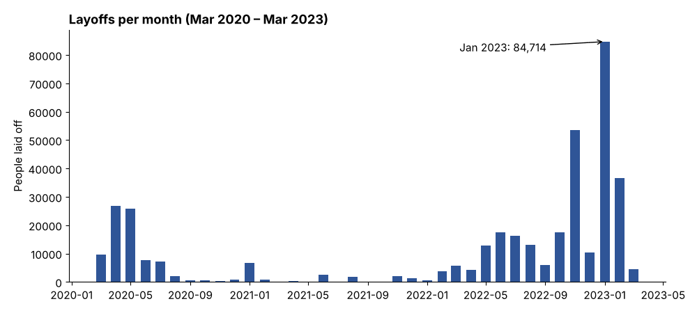
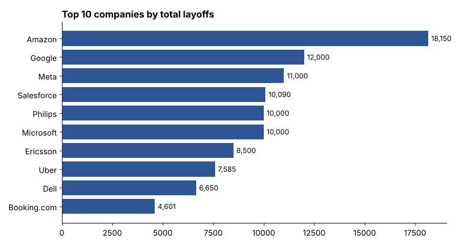
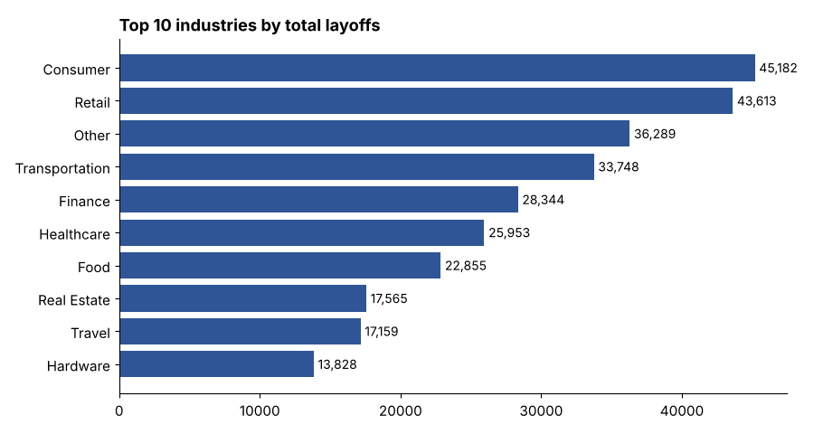

# World Layoffs Analysis (2020–2023) — SQL Data Cleaning & EDA

A MySQL project that takes a messy dataset of **2,361 tech layoff records**, cleans it into **1,995 reliable rows**, and then explores it to answer: *who laid off the most people, where, in which industries, and when?*

**Tools:** MySQL 8 (MySQL Workbench) · SQL: CTEs, window functions (ROW_NUMBER, DENSE_RANK, running SUM), self joins, string and date functions · Python (pandas, matplotlib) for the charts

---

## Key findings

| | |
|---|---|
| Period covered | 11 Mar 2020 – 6 Mar 2023 |
| Total people laid off | **383,659** |
| Worst month | **January 2023 — 84,714** layoffs |
| Biggest single layoff | Google, 12,000 (Jan 2023) |
| Most layoffs overall | Amazon 18,150 · Google 12,000 · Meta 11,000 |
| Country | United States = **~67%** of all layoffs, then India (35,993) |
| City | SF Bay Area 125,631 — more than the next 4 cities combined |
| Company stage | Post-IPO (large public) companies = 204,132 |
| Companies that shut down (100% laid off) | 116 — incl. Britishvolt ($2.4B raised) and Quibi ($1.8B) |

- **Two waves:** a COVID wave in Apr–May 2020, a quiet 2021 (15,823), then a much larger wave from mid-2022. The first 3 months of 2023 (125,677) almost matched all of 2022 (160,661).
- **Big tech led the 2022–23 wave:** the top 3 per year moved from travel and delivery (Uber, Booking.com, Groupon in 2020) to big tech (Meta, Amazon in 2022; Google, Microsoft in 2023).
- **Consumer and Retail** were the hardest-hit industries.



<p float="left">
  
  
</p>

---

## Data cleaning — what was wrong and how I fixed it

| Problem found | Fix | Rows affected |
|---|---|---|
| No ID column; exact duplicate rows | `ROW_NUMBER() OVER (PARTITION BY` all 9 columns`)`, delete `row_num > 1` | 5 removed |
| Extra spaces in company names (`' E Inc.'`, `'WeWork '`) | `TRIM()` | 11 |
| Same industry spelled 3 ways (`Crypto`, `Crypto Currency`, `CryptoCurrency`) | standardized to `Crypto` | 3 |
| `United States.` with a full stop | `TRIM(TRAILING '.' FROM country)` | 4 |
| Same city spelled two ways (`Dusseldorf`/`Düsseldorf`, `Malmo`/`Malmö`) | standardized | 2 |
| Date stored as text (`3/6/2023`) | `STR_TO_DATE()` then changed column type to `DATE` | all |
| Blank / NULL industry | blanks → NULL, then filled from the same company's other rows with a **self join** (Airbnb → Travel, Carvana → Transportation, Juul → Consumer) | 3 filled, 1 left NULL (Bally's Interactive has no other row, so I didn't guess) |
| Rows with **no** layoff count **and no** percentage | deleted — they say nothing about layoffs | 361 removed |
| Helper `row_num` column | dropped | — |

Missing numbers in `total_laid_off`, `percentage_laid_off` and `funds_raised_millions` were **kept as NULL**, not replaced with 0 or an average, because that would change the totals.

**Result:** 2,361 raw rows → **1,995 clean rows**. The raw table is never edited; all work happens in a staging copy.

---

## Project structure

```
world-layoffs-sql-analysis/
├── data/
│   └── layoffs_raw.csv          # original data (2,361 rows)
├── sql/
│   ├── 01_create_and_load.sql   # create database + load CSV
│   ├── 02_data_cleaning.sql     # duplicates, standardizing, NULLs, dates
│   └── 03_eda.sql               # exploratory analysis queries
├── images/                      # charts used in this README
└── make_charts.py               # repeats the cleaning in pandas (to cross-check the SQL) and builds the charts
```

## How to run

1. Install **MySQL 8** and **MySQL Workbench**.
2. Open `sql/01_create_and_load.sql`, change the CSV path to where `data/layoffs_raw.csv` is on your computer, and run it. The row count should be **2,361**. (You can also use Workbench's *Table Data Import Wizard*.)
3. Run `sql/02_data_cleaning.sql`. The final row count should be **1,995**.
4. Run the queries in `sql/03_eda.sql` one by one. The expected results are written in the comments.
5. (Optional) `pip install pandas matplotlib` then `python make_charts.py`. It repeats the cleaning in pandas (also 1,995 rows), saves `data/layoffs_clean.csv` and rebuilds the charts.

---

## Credits

- Project idea and walkthrough: **Alex The Analyst** — [Learn SQL Beginner to Advanced in Under 4 Hours](https://www.youtube.com/watch?v=OT1RErkfLNQ) (data cleaning and EDA projects).
- Dataset: [Layoffs 2022 on Kaggle](https://www.kaggle.com/datasets/swaptr/layoffs-2022) (as shared in [AlexTheAnalyst/MySQL-YouTube-Series](https://github.com/AlexTheAnalyst/MySQL-YouTube-Series)).

I followed the course and then added my own changes: fixing city spellings (Düsseldorf, Malmö), converting the percentage column to a number, loading the CSV with `LOAD DATA` so `'NULL'` text becomes real NULLs, each country's share of total layoffs, and charts made in Python.
